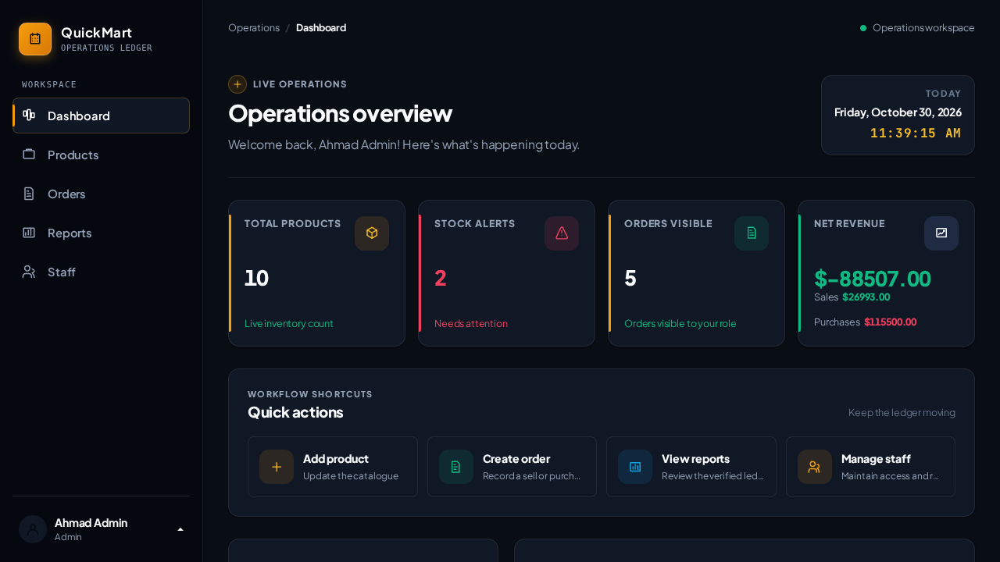
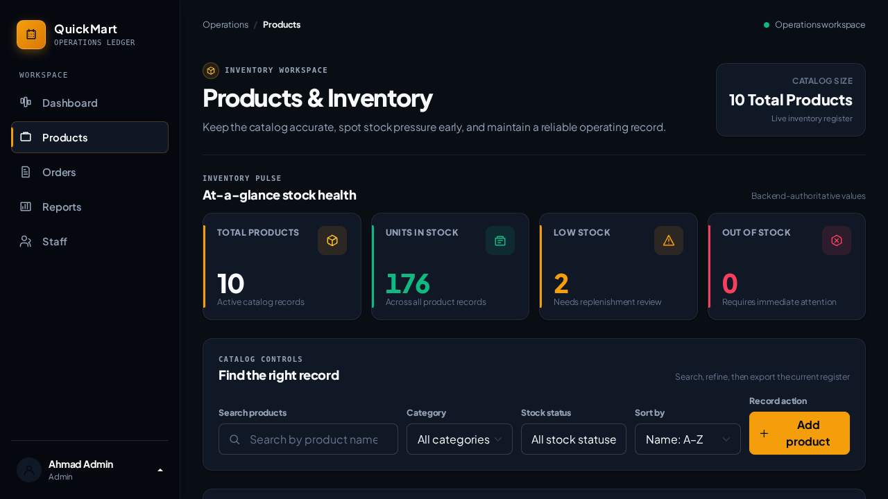
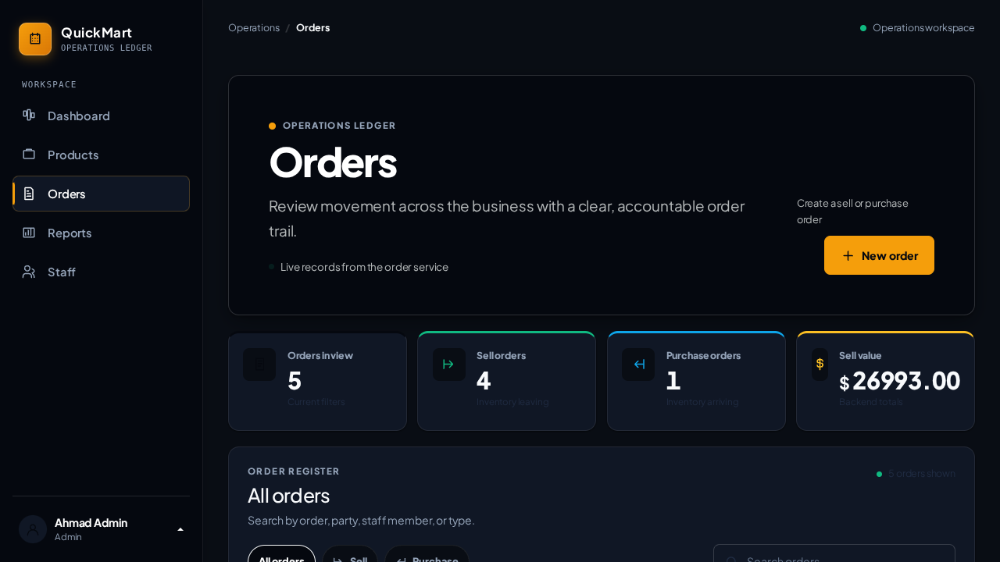
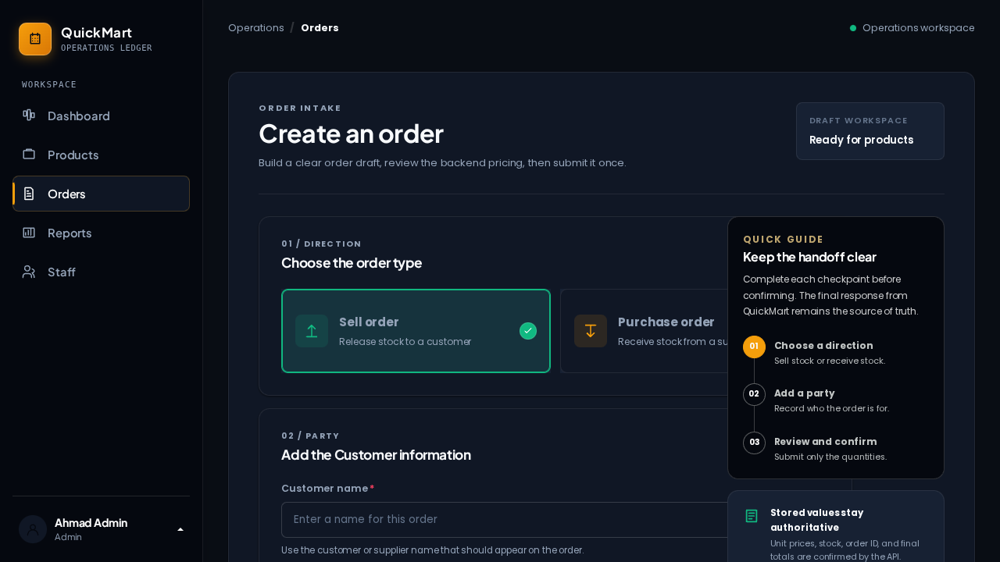
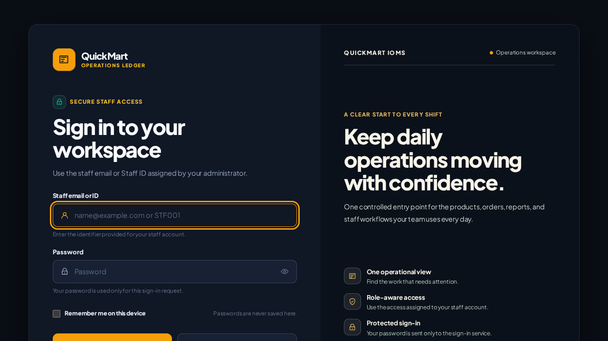
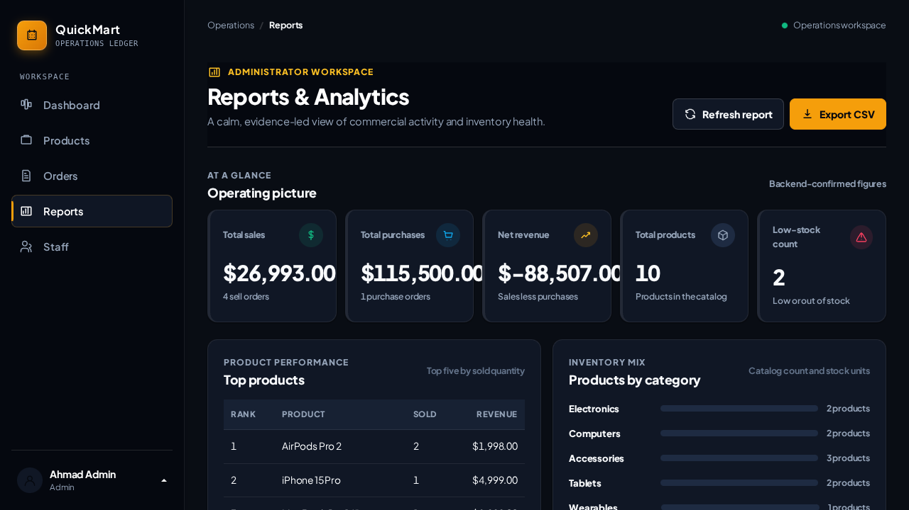
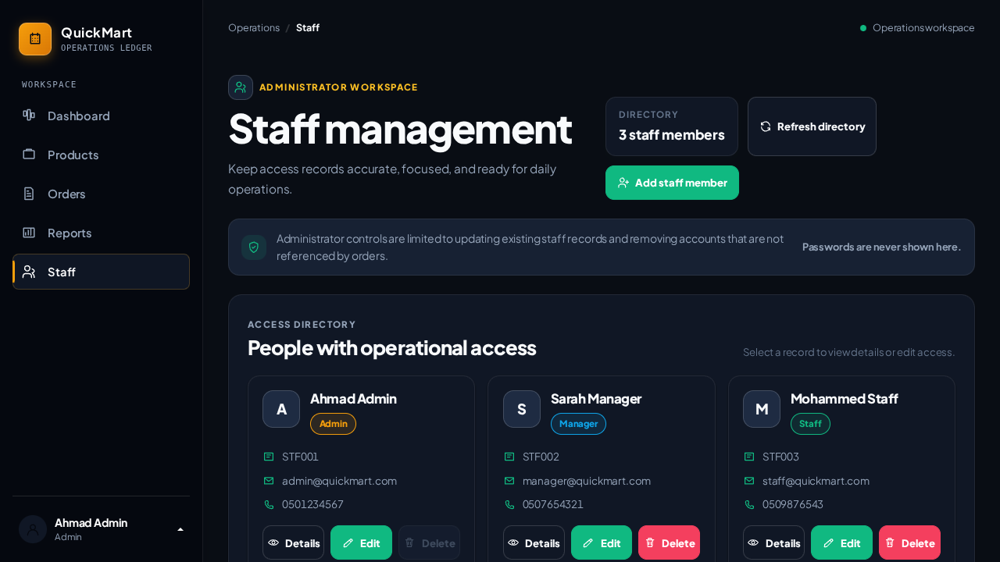
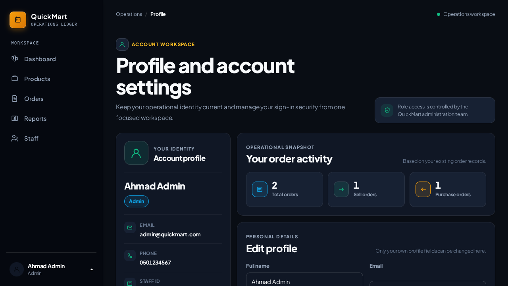

# QuickMart IOMS

**QuickMart Inventory & Operations Management System** is a responsive retail operations platform built with Node.js 22 LTS and Express 5 Clean Architecture. It features an Executive Obsidian & Warm Gold design system with Plus Jakarta Sans and JetBrains Mono typography, high-contrast accessible data tables, live stock tracking, transactional order workflows, and role-based access control.

---

## System Gallery

| Operations Dashboard | Inventory & Products |
| :---: | :---: |
|  |  |
| *Real-time metrics, stock health alerts, and recent orders* | *Catalog filtering, stock status badges, and price controls* |

| Order Management | Create Order Workflow |
| :---: | :---: |
|  |  |
| *Filterable order register with role-scoped visibility* | *Sell/Purchase order entry with atomic stock validation* |

| Secure Staff Sign-In | Executive Analytics & Reports |
| :---: | :---: |
|  |  |
| *Rate-limited authentication with session CSRF protection* | *Turnover metrics, category distributions, and monthly trends* |

| Staff Management | Account & Profile Settings |
| :---: | :---: |
|  |  |
| *Access directory, role assignments, and account controls* | *Personal information, password updates, and order activity* |

---

## Key Features

- **Inventory Registers**: Semantic states (`Normal`, `Low Stock`, `Out of Stock`) based on configurable thresholds.
- **Transactional Orders**: Real-time stock validation for Sell orders; automatic replenishment for Purchases.
- **Immutable Pricing**: Historical order lines store transaction-time pricing (`Sold_Price`) unaffected by catalog price adjustments.
- **Role-Based Access Control**:
  - `Admin`: Full access to inventory, orders, staff administration, and financial reporting.
  - `Manager`: Product catalog management and store order processing.
  - `Staff`: Restricted view of assigned orders and self-service profile management.
- **Audit Safeguards**: Products and staff members referenced in order history cannot be deleted.
- **Self-Hosted Assets**: Bootstrap 5.3.0, Poppins fonts, and icons are bundled locally with zero third-party CDN reliance.

---

## Quick Start

### Prerequisites
- Node.js 20+ or 22 LTS
- npm 10+

### Installation & Build

```bash
# Install dependencies
npm install

# Compile production CSS and JavaScript assets
npm run build
```

### Running the Server

```bash
# Start development server on http://localhost:3000
npm run dev

# Start production server
npm start

# Run syntax validation
npm run lint
```

---

## Demo Credentials

| Role | Identifier / Email | Password | Scope |
| --- | --- | --- | --- |
| **Admin** | `admin@quickmart.com` (`STF001`) | `admin123` | Full system access, staff, reports, catalog |
| **Manager** | `manager@quickmart.com` (`STF002`) | `admin123` | Products, store operations, orders |
| **Staff** | `staff@quickmart.com` (`STF003`) | `admin123` | Assigned orders, order creation, profile |

---

## Architecture & Code Structure

The project implements **Clean Architecture** to decouple presentation from business invariants:

```text
QuickMart-IOMS/
├── server.js               # HTTP server entrypoint (port 3000)
├── src/
│   ├── app.js              # Express app factory & middleware pipeline
│   ├── config/             # Immutable roles, order types, and rate limits
│   ├── data/               # In-memory repositories & sequence generators
│   ├── middleware/         # Security headers, session/CSRF, and rate limiting
│   ├── routes/             # Web views and JSON API controllers
│   ├── services/           # Domain logic (Auth, Products, Orders, Reports, Staff)
│   ├── utils/              # Standard JSON envelope helpers
│   └── views/              # View compilation & memory template cache
├── assets/                 # Raw styles, scripts, fonts, icons, and login UI
├── dist/                   # Minified production CSS and JavaScript bundles
├── docs/                   # Documentation & system screenshots
└── scripts/                # Asset compilation tools (Clean-CSS & Terser)
```

---

## API Overview

All API endpoints return a standardized JSON envelope: `{ "success": boolean, "message": string, "data": any }`.

| Domain | Base Path | Endpoints | Access |
| --- | --- | --- | --- |
| **Auth** | `/backend/api/auth` | `/session.php`, `/csrf.php`, `/login.php`, `/logout.php` | Public / Authenticated |
| **Products** | `/backend/api/products` | `/list.php`, `/get.php`, `/create.php`, `/update.php`, `/delete.php` | Authenticated / Admin / Manager |
| **Orders** | `/backend/api/orders` | `/list.php`, `/get.php`, `/create.php` | Authenticated (Role-scoped) |
| **Staff** | `/backend/api/staff` | `/list.php`, `/create.php`, `/update.php`, `/delete.php`, `/update-profile.php`, `/change-password.php` | Admin / Self-service |
| **Reports** | `/backend/api/reports` | `/stats.php` | Admin only |

---

## Security Highlights

- **Bcrypt Hashing**: Passwords encrypted using `bcryptjs` with salt rounds.
- **Brute-Force Defense**: Sliding-window rate limiting on login (10 attempts / 15 minutes) with HTTP 429 and `Retry-After`.
- **Session & CSRF Protection**: HTTP-only cookies (`qm_session_id`) and cryptographic session-bound CSRF token verification.
- **Defensive Headers**: Enforces `X-Content-Type-Options: nosniff`, `X-Frame-Options: DENY`, and `Referrer-Policy: same-origin`.

---

## Author & Attribution

Developed by **Mohammad Emad** — [GitHub](https://github.com/mohammad-emad-dev)
