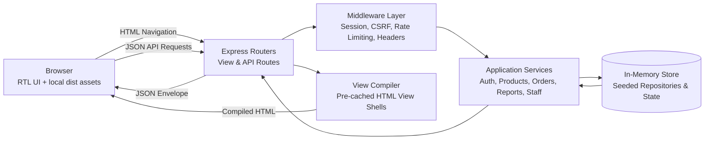
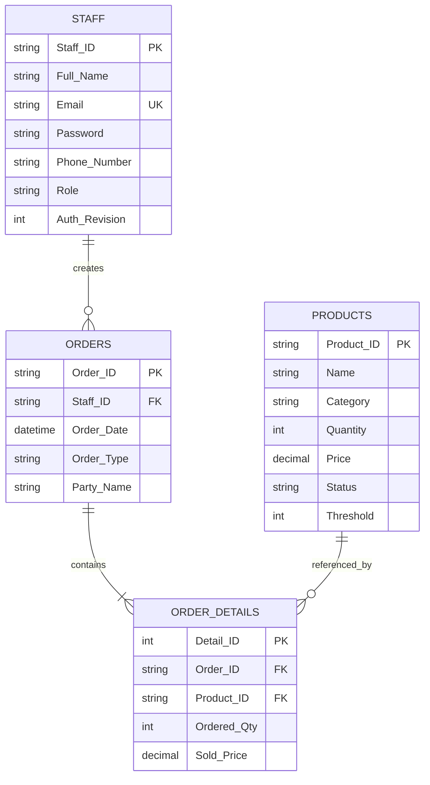

# QuickMart IOMS

## Engineering README

QuickMart IOMS is a secure, responsive inventory and order-management system for retail operations. It features an RTL-first operations console with Arabic-friendly typography, dark theme tokens, live inventory health tracking, and transactional order workflows.

The system is implemented as a **Node.js / Express** application following **Clean Architecture** principles, with in-memory persistence, server-authoritative role-based access control (RBAC), and a reproducible frontend build pipeline.

---

## Engineering Stance & Principles

- **Server-Authoritative Operations**: The backend is the sole authority for authentication, authorization, inventory counts, unit prices, line totals, order identifiers, and role policies. The browser handles presentation and user interaction only.
- **Clean Architecture & Separation of Concerns**:
  - **Routes** handle HTTP parameter extraction and response statuses.
  - **Services** enforce domain invariants (e.g. stock availability on Sell orders, foreign-key reference integrity, and role constraints).
  - **Store / Repositories** manage state and atomic sequence generators.
  - **Views** pre-compile and cache HTML shells at startup to eliminate disk I/O at runtime.
- **Defense in Depth**: Strict validation at trust boundaries, rate-limited login attempts, session-bound CSRF token rotation, and HTTP-only session cookies.
- **Zero External Runtime Dependencies for UI**: Bootstrap 5.3.0, Poppins fonts, and SVG icons are self-hosted and compiled locally. The application works offline and in restricted network environments without third-party CDN calls.

---

## Current Capabilities

- **Product Catalog & Inventory**:
  - Live inventory registers with `Normal`, `Low Stock`, and `Out of Stock` semantic states.
  - Dynamic categorization, search filtering, and CSV export.
  - Administrative creation, editing, and reference-checked deletion.
- **Order Management**:
  - **Sell Orders**: Guided multi-item intake with real-time stock validation, automated inventory deduction, and insufficient-stock protection.
  - **Purchase Orders**: Stock replenishment workflows with automatic status updates.
  - **Immutable History**: Historical order inspection using stored line prices rather than floating catalog prices.
  - Clean A4 portrait printable invoice views.
- **Role-Based Access Control (RBAC)**:
  - `Admin`: Global visibility, catalog management, staff management, and operational KPI reporting.
  - `Manager`: Catalog mutations, store operations, and order placement.
  - `Staff`: Restricted view of assigned orders, self-service profile management, and order placement.
- **Staff & Account Security**:
  - Administrative staff directory with duplicate-email prevention and order-history deletion guards.
  - Self-service profile updates and password changes with Bcrypt encryption.
  - One-way windowed rate limiting on authentication attempts (`Retry-After: 900`).

---

## Technology Stack

- **Runtime**: Node.js 22 (LTS)
- **Application Server**: Express 5
- **Security & Cryptography**: `bcryptjs`, `cookie-parser`, native `node:crypto`
- **Frontend**: Vanilla JavaScript (ES6+), local Bootstrap 5.3.0 bundle, custom CSS tokens
- **Build Pipeline**: `clean-css` for CSS optimization, `terser` for JavaScript minification
- **Schema & Reference Models**: MariaDB/PostgreSQL-compatible relational schema definitions (`database/schema.sql`, `database/data.sql`)

---

## Runtime Architecture



---

## Project Structure

```text
QuickMart-IOMS/
├── server.js                           # Application entrypoint & HTTP server bootstrap
├── src/
│   ├── app.js                          # Express application factory & middleware setup
│   ├── config/
│   │   └── app-constants.js            # System roles, order types, statuses & rate limits
│   ├── data/
│   │   └── inventory-store.js          # In-memory entity repository & sequence generators
│   ├── middleware/
│   │   ├── rate-limiter.js             # Windowed login attempt throttling
│   │   ├── security-headers.js         # Security headers (nosniff, DENY, same-origin)
│   │   └── session-middleware.js       # Cookie session resolution & RBAC route guards
│   ├── routes/
│   │   ├── auth-routes.js              # Session probe, CSRF, login, and logout endpoints
│   │   ├── order-routes.js             # Order listing, details, and placement endpoints
│   │   ├── product-routes.js           # Catalog retrieval, creation, update, and deletion
│   │   ├── report-routes.js            # Operational KPI reporting (Admin-only)
│   │   ├── staff-routes.js             # Staff directory, profile, and password management
│   │   └── view-routes.js              # Protected HTML view delivery & 403 access gates
│   ├── services/
│   │   ├── auth-service.js             # Credential verification & CSRF token generator
│   │   ├── order-service.js            # Stock verification, pricing, and transactional order logic
│   │   ├── product-service.js          # Stock status derivation & catalog reference integrity
│   │   ├── report-service.js           # Category, monthly trend, and top-product aggregations
│   │   └── staff-service.js            # Profile updates, password hashing, and user deletion guards
│   ├── utils/
│   │   └── api-response.js             # Standardized API response envelopes
│   └── views/
│       └── view-compiler.js            # Startup view compilation & memory pre-caching
├── assets/                             # Source stylesheets, client scripts, icons, fonts
│   ├── common.css                      # Core design tokens and shell styles
│   ├── common.js                       # Client-side session probe and apiFetch helper
│   ├── fonts/                          # Self-hosted Poppins font subsets
│   ├── login-signup/                   # Sign-in page markup and interaction logic
│   └── vendor/bootstrap/               # Self-hosted Bootstrap 5.3.0 bundle
├── backend/views/partials/             # Component HTML partials compiled by view-compiler
│   ├── create-order/                   # Order creation step partials
│   ├── dashboard/                      # Overview and activity widget partials
│   ├── order-details/                  # Order details invoice template
│   ├── orders/                         # Order register and filter partials
│   ├── products/                       # Catalog overview and table partials
│   ├── profile/                        # Account profile and settings partials
│   ├── reports/                        # Report summaries, charts, and metrics partials
│   ├── shell-nav.php                   # Shared primary navigation bar
│   └── staff/                          # Staff directory and dialog partials
├── database/
│   ├── schema.sql                      # Baseline relational database schema
│   └── data.sql                        # Reference initial seed data
├── dist/                               # Minified production CSS and JavaScript outputs
├── scripts/
│   ├── build-css.js                    # Production CSS compilation script (clean-css)
│   └── build-js.js                     # Production JavaScript compilation script (terser)
├── index.html                          # Root redirect and OpenGraph entrypoint
├── metadata.json                       # Applet configuration and permissions
├── package.json                        # Dependencies, build, and validation scripts
└── README.md                           # Project engineering documentation
```

---

## Getting Started

### Prerequisites

- **Node.js**: v22.x or newer
- **npm**: v10.x or newer

### Installation

1. Install project dependencies:

   ```bash
   npm install
   ```

2. Build production assets:

   ```bash
   npm run build
   ```

   This executes `scripts/build-css.js` and `scripts/build-js.js`, compiling readable assets from `assets/` into optimized production files in `dist/`.

### Running the Application

- **Development Server**:

  ```bash
  npm run dev
  ```

  Starts the application on `http://0.0.0.0:3000`.

- **Production Server**:

  ```bash
  npm start
  ```

- **Code Validation & Linting**:

  ```bash
  npm run lint
  ```

  Performs syntax verification across `server.js`, `src/**/*.js`, and `scripts/*.js`.

---

## Seed Accounts & Roles

The system is pre-seeded with sample operational accounts:

| Identifier / Email | Role | Default Password | Permissions |
| --- | --- | --- | --- |
| `admin@quickmart.com` (`STF001`) | `Admin` | `admin123` | Full access, staff management, reports, all orders, catalog |
| `manager@quickmart.com` (`STF002`) | `Manager` | `admin123` | Catalog creation/editing, order placement, order history |
| `staff@quickmart.com` (`STF003`) | `Staff` | `admin123` | Assigned order history, order creation, own profile settings |

*Note: Seed accounts are for demonstration and testing. Rotate all passwords prior to production deployment.*

---

## API Surface

All API endpoints return JSON conforming to the standardized envelope:

```json
{
  "success": true,
  "message": "Success",
  "data": { ... }
}
```

### 1. Authentication (`/backend/api/auth`)

| Method | Endpoint | Authorization | Purpose |
| --- | --- | --- | --- |
| `GET` | `/csrf.php` | Public | Returns the session-bound CSRF token. |
| `GET` | `/session.php` | Authenticated | Validates session and returns current staff identity. |
| `POST` | `/login.php` | Public | Authenticates credentials and issues session cookie. |
| `POST` | `/logout.php` | Authenticated | Clears session data and invalidates cookie. |
| `POST` | `/forgot_password.php` | Public | Returns HTTP 503 until an approved delivery service is configured. |

### 2. Products (`/backend/api/products`)

| Method | Endpoint | Authorization | Purpose |
| --- | --- | --- | --- |
| `GET` | `/list.php` | Authenticated | Returns products filtered by `category`, `status`, or `search`. |
| `GET` | `/get.php?id={id}` | Authenticated | Retrieves a single product by `Product_ID`. |
| `POST` | `/create.php` | Admin, Manager | Creates a new product and recalculates status. |
| `PUT` | `/update.php` | Admin, Manager | Updates existing product details and threshold status. |
| `ALL` | `/delete.php` | Admin | Deletes a product (blocked if referenced in order history). |

### 3. Orders (`/backend/api/orders`)

| Method | Endpoint | Authorization | Purpose |
| --- | --- | --- | --- |
| `GET` | `/list.php` | Authenticated | Lists orders. Filterable by `type`, `staff_id`, `date_from`, `date_to`. Staff role is restricted to own orders. |
| `GET` | `/get.php?id={id}` | Authenticated | Retrieves order header and line items with historical stored prices. |
| `POST` | `/create.php` | Authenticated | Creates a sell or purchase order transactionally and updates stock. |

### 4. Staff Management (`/backend/api/staff`)

| Method | Endpoint | Authorization | Purpose |
| --- | --- | --- | --- |
| `GET` | `/list.php` | Admin | Lists all staff members without exposing passwords. |
| `GET` | `/get.php?id={id}` | Authenticated | Reads a permitted staff record (Admin or self). |
| `POST` | `/create.php` | Admin | Creates a staff account with encrypted password. |
| `POST` | `/update.php` | Admin | Updates staff details and roles. |
| `POST` | `/delete.php` | Admin | Deletes a staff account (blocked if user has order records or self). |
| `POST` | `/update-profile.php` | Authenticated | Updates the current authenticated user's profile. |
| `POST` | `/change-password.php` | Authenticated | Changes password after validating current password. |

### 5. Reporting (`/backend/api/reports`)

| Method | Endpoint | Authorization | Purpose |
| --- | --- | --- | --- |
| `GET` | `/stats.php` | Admin | Aggregates summary KPIs, category distributions, recent orders, top products, and monthly trends. |

---

## Relational Entity Model



---

## Security & Reliability Controls

- **Bcrypt Password Storage**: Passwords are cryptographically hashed using `bcryptjs` with salt rounds. Raw passwords never leave the authentication boundary.
- **CSRF Token Verification**: Mutating requests require matching session CSRF tokens in headers.
- **Strict Role-Based Guards**: Protected endpoints check the session identity at the middleware layer before invoking application services.
- **Transaction-Safe Stock Updates**: Sell orders check current available stock before mutating quantities. If any product in a multi-item order has insufficient stock, the entire order fails closed with zero stock mutation.
- **Historical Price Immutability**: `Order_Details.Sold_Price` captures the unit price at the time of transaction. Subsequent product catalog price adjustments never mutate historical order totals.
- **Data Deletion Integrity**: Products and staff members that are referenced in historical orders cannot be deleted, preserving audit trails.

---

## Author & Attribution

Developed by **Mohammad Emad** — [GitHub](https://github.com/mohammad-emad-dev)
